Проведем анализ метода fANOVA. Сначала разберемся, что он из себя представляет и что такое обычное ANOVA.

## РАЗБИРАЕМСЯ С ТЕОРИЕЙ
ANOVA это дисперсионный позволяющий выяснить, влияют ли определенные величины\факторы на итоговую величину. По сути это метод основанный на статистическом сравнении различных групп, проверяя например с помощью F-теста, что их средние одинаковые. Это однофакторная ANOVA. В двухфакторной ANOVA мы исследуем формулу $y = A + B + AB + \epsilon$, где AB - взаимодейсвтие факторов A и B.

fANOVA это функциональное ANOVA разложение, где мы исследуем уже не просто среднее в группах, а произвольную функцию $y = f(x_1, x_2, ..., x_p)$.

Самое интересное, что это может быть функция, которую выучила та или иная модель, например RF или нейросеть. И задача fANOVA в том, чтобы разложить эту функцию на

$$
f(X) = f_0 + \sum_{i=1}^{d} f_i(x_i) + \sum_{i \lt j} f_{ij}(x_i,x_j) + \sum_{i \lt j \lt k} f_{ijk}(x_i,x_j,x_k) + \cdots
$$

где $f_0$ - среднее значение функции, $f_i(x_i)$ - главный эффект признака $x_i$, $f_{ij}(x_i,x_j)$ - парное взаимодействие и т.д.

Как же fANOVA измеряет величину эффекта?

$$
V_S=\mathbb E[f_S(X_S)^2]
$$

Если признаки независимы, то компоненты будут центрированы, поэтому $V_S=Var(f_S(X_S))$.

Нормированная энергия:

$$
E_S=\frac{V_S}{Var(f(X))}.
$$

Для независимых ортогональных признаков верно:

$$
\sum_{S\ne\varnothing}E_S=1.
$$

то есть энергии складываются как независимые доли объясненной дисперсии. Но при зависимых признаках так делать уже нельзя. Как же находить эти компоненты?

Есть 2 основных способа рассчета компонентов функции: условный(conditional) и безусловный(marginal). Они отличаются тем, как учитывают остальные признаки помимо рассматриваемых. В безусловном способе при вычислении компонент остальные признаки усредняются по произведению их маргинальных распределений, без сохранения статистической зависимости с фиксированными признаками, в то время как в условном используются условные математические ожидания с учётом совместного распределения признаков. На синтетике это можно рассчитать с помощью известных распределений, а на реальных данных мы используем эмпирическое маргинальное распределение для безусловного и kNN для условного метода.

Пусть $P_j$ — одномерное распределение $X_j$, а

$$
Q=\bigotimes_{j=1}^{d}P_j
$$

— произведение маргинальных распределений

Тогда:

$$
v_S^{M}(x_S)=\int f(x_S,x_{-S})\prod_{j\notin S}\mathrm dP_j(x_j) = \mathbb E_{\prod_{j\notin S}P_j}f(x_S,X_{-S})
$$

это безусловный метод.

Пусть $P_X$ — фактическое совместное распределение входов. Тогда

$$
v_S^{C}(x_S)=\int f(x_S,x_{-S})\,\mathrm dP(x_{-S}\mid x_S)
=\mathbb E[f(X)\mid X_S=x_S]
$$

это условный (conditional) метод

Таким образом, $$f_S(x_S) = v_S(x_S) - \sum_{T\subsetneq S}f_T(x_T)$$, в зависимости от выбранного метода.

## ЭКСПЕРИМЕНТЫ

В эксперименте исследуем 10 функций с 10 признаками и корреляцией $\rho=0,0.05,\ldots,1$ между $X_1$ и $X_2$; сопоставляем Truth (рассчитанное по формулам или в отдельных местах с помощью монте-карло) и предсказания модели, Marginal и Conditional. Также рассмотрим работу на реальных данных (California Housing и Airfoil). Для них рассчитываются компоненты только по модели.

### Синтетика

**Исследуемые функции:**

1. **Linear:** $y = 2x_1 + 0.7x_3$
2. **Product:** $y = x_1x_2$
3. **Add Product:** $y = x_1 + x_2 + 0.8x_1x_2$
4. **Square Sum:** $y = (x_1+x_2)^2$
5. **Sin Product:** $y = \sin(3x_1x_2)$
6. **Sin Plus Product:** $y = 1.5\sin(x_1) + 0.7\cos(x_4) + x_1x_2$
7. **Threshold Pair:** $y = \mathbf{1}[x_1>0,\ x_2>0]$
8. **Threshold Triple:** $y = \mathbf{1}[x_1>0,\ x_2>0,\ x_3>0]$
9. **Disjoint Pairs:** $y = x_1x_3 + 0.5x_2x_4 + 1.5x_5$
10. **Mixed:** $y = x_1x_2 + 0.4x_3x_4 + 1.7x_5 + 0.5(x_6^2-1) + 0.7\sin(x_7) + 0.2x_8x_9$

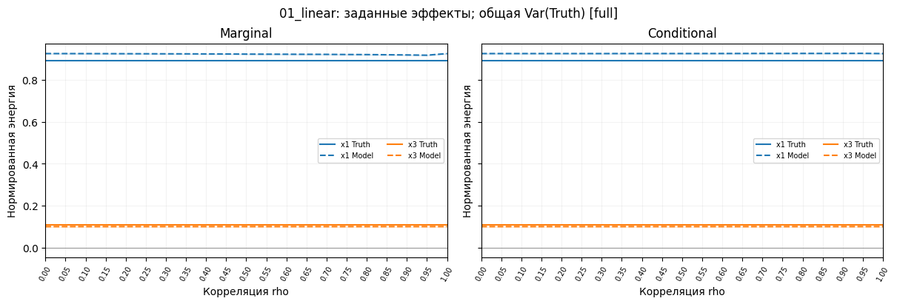
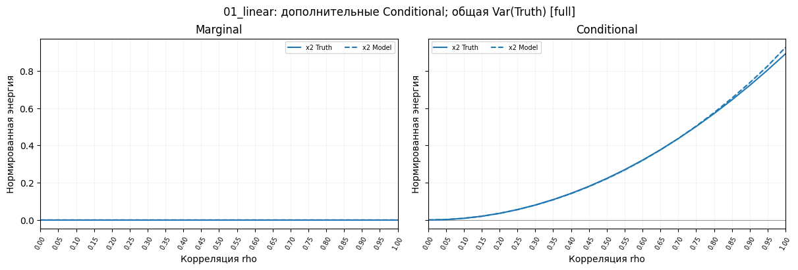

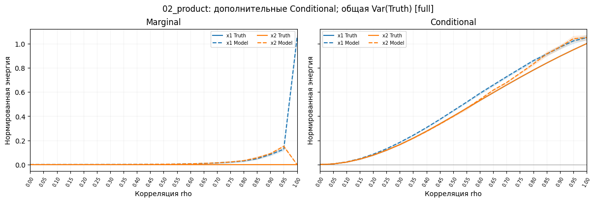
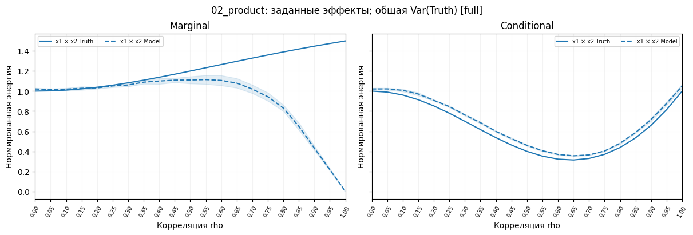
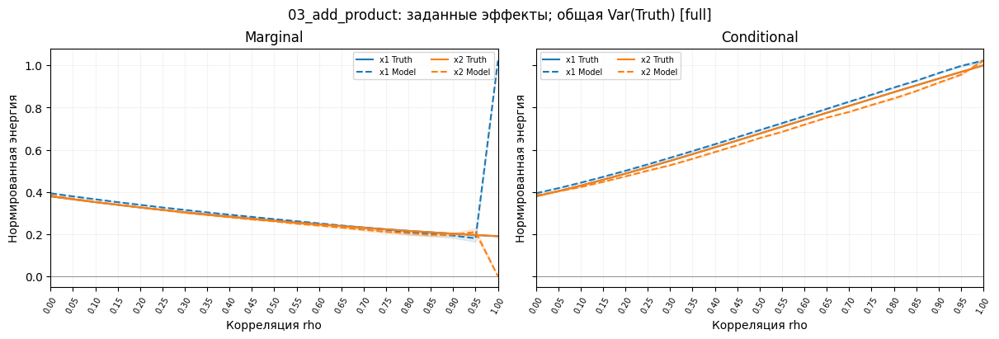
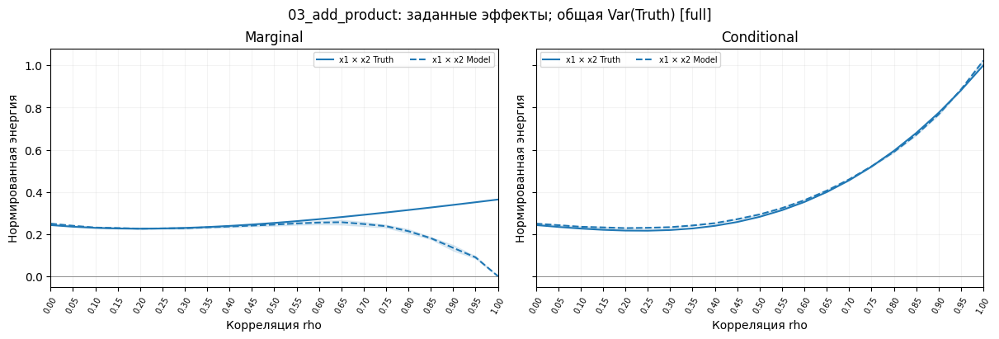
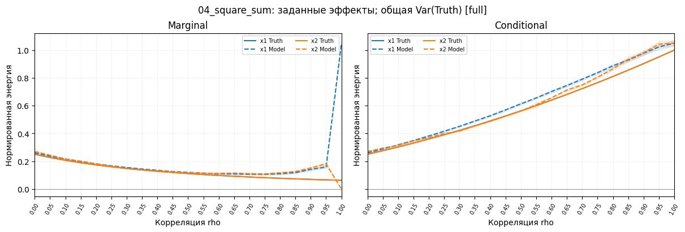
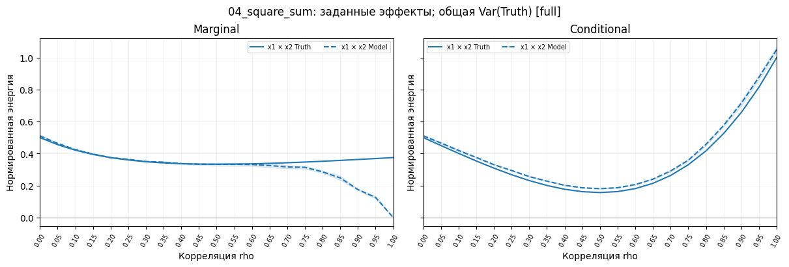
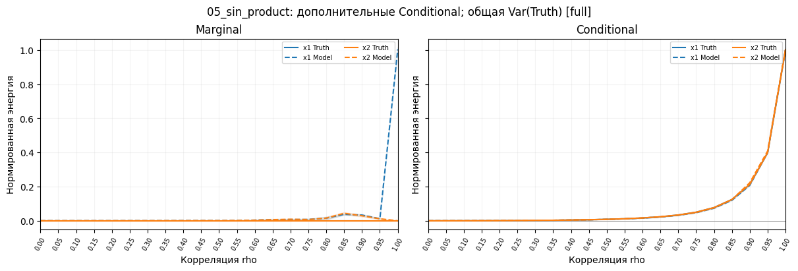
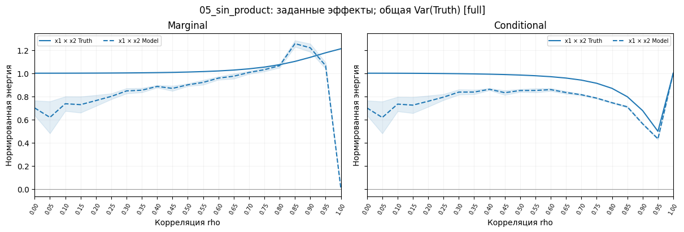
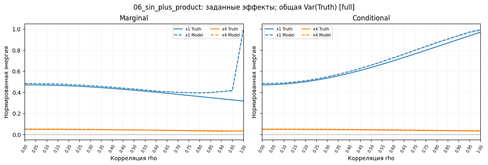
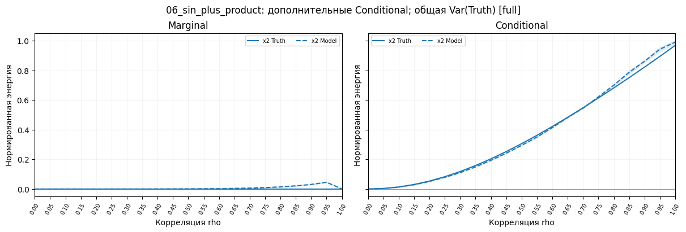
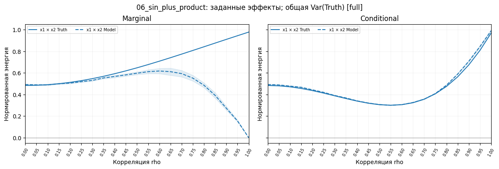
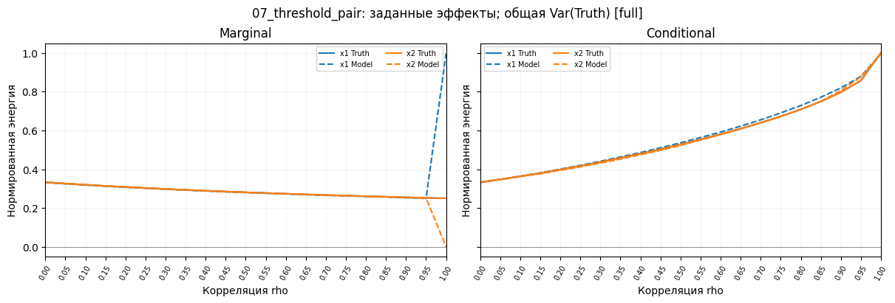
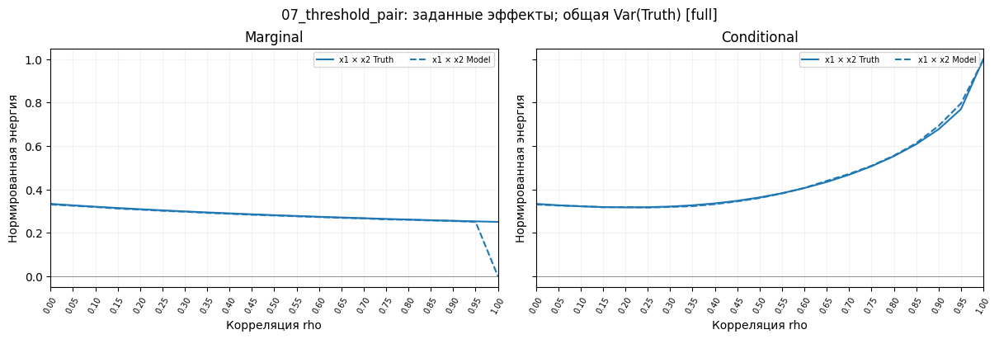
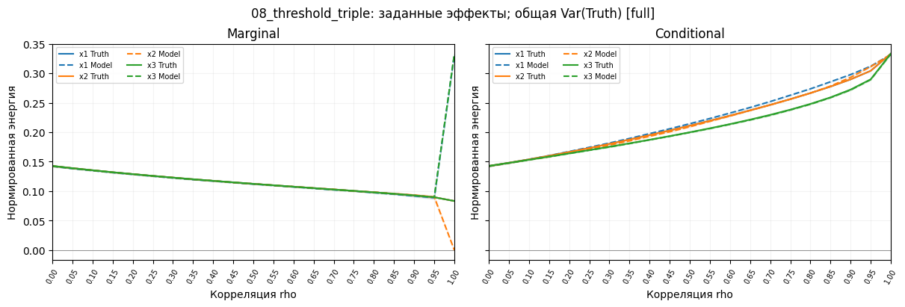
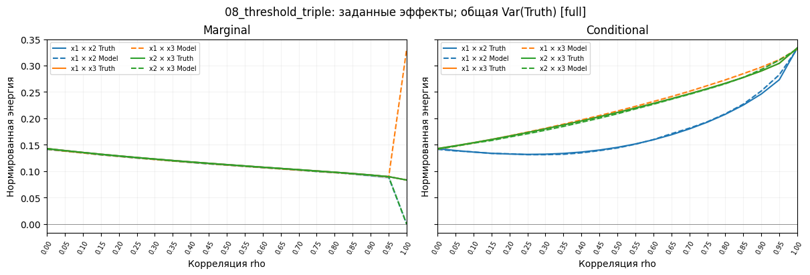
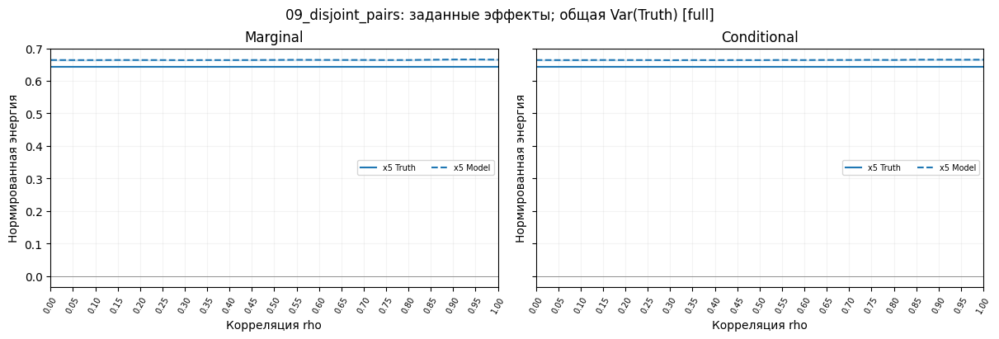
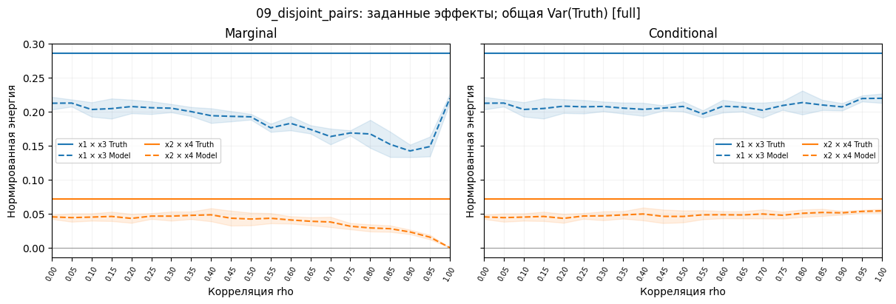
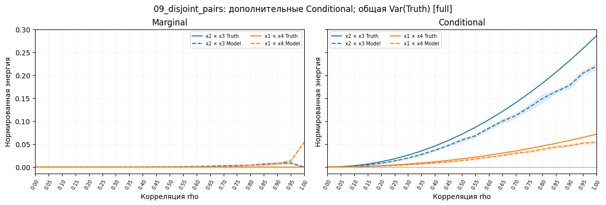
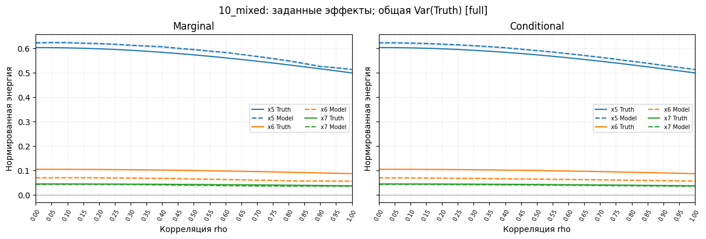
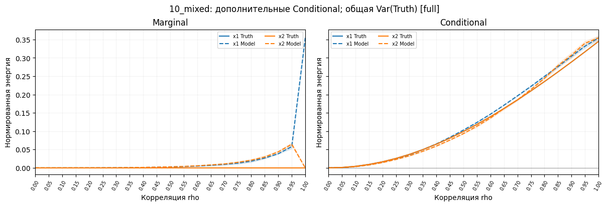
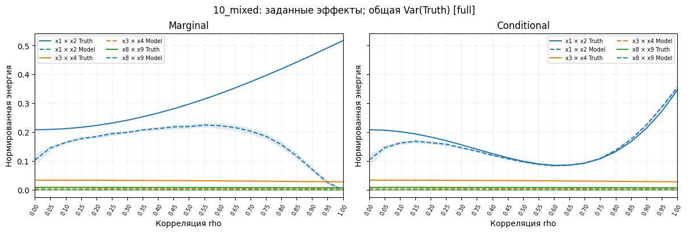

Видим, что при увеличении корреляции на всех графиках в Marginal показания модели расходятся с формулой. В большинстве случаев Conditional повторяет выход модели. Несовпадения в Conditional объясняются частично тем, что модель недоучивает нужные пары. Расхождения в Marginal объясним на примере:

$$
f(x_1,x_2)=x_1x_2
$$

признаки имеют совместное нормальное распределение:

$$
\begin{pmatrix}
X_1 \\
X_2
\end{pmatrix}
\sim
\mathcal{N}\left(
\begin{pmatrix}
0 \\
0
\end{pmatrix},
\begin{pmatrix}
1 & \rho \\
\rho & 1
\end{pmatrix}
\right)
$$

При этом: $X_2=\rho X_1+\sqrt{1-\rho^2}Z, Z\sim\mathcal N(0,1),$ где $Z$ независим от $X_1$

При $\rho\to1$: $X_2\approx X_1$. Следовательно: $X_1X_2\approx X_1^2$

Это означает, что модель может научиться приближать произведение двух признаков, фактически используя только один признак.

$\mathbb E[X_1X_2\mid X_1=x_1] =x_1\mathbb E[X_2\mid X_1=x_1]=\rho x_1^2$ (оптимальный по RMSE)

тогда пусть модель:

$$
\hat f(x_1,x_2)=\rho x_1^2
$$

Ошибка модели: $MSE=\mathbb E[(X_1X_2-\rho X_1^2)^2]=\mathbb E[X_1^2(X_2-\rho X_1)^2]$

Но т.к. $X_2-\rho X_1=\sqrt{1-\rho^2}Z$, то $MSE=(1-\rho^2)\mathbb E[X_1^2Z^2]=(1-\rho^2)\mathbb E[X_1^2]\mathbb E[Z^2]=1-\rho^2$

Итак, найдем что будет выдавать ANOVA для истинной функции $f=x_1x_2$: \
$v_\varnothing^M=\mathbb E_Q[X_1X_2]=0,$ \
$v_1^M(x_1)=\mathbb E_{X_2}[x_1X_2]=x_1\mathbb E[X_2]=0,$ \
$v_2^M(x_2)=x_2\mathbb E[X_1]=0,$ \
$v_{12}^M(x_1,x_2)=x_1x_2$

Следовательно: $f_{12}^{M,\mathrm{Truth}}(x_1,x_2)=x_1x_2$

Теперь для модели $\hat f(x_1,x_2)=\rho x_1^2$: \
$\hat v_\varnothing^M=\rho\mathbb E[X_1^2]=\rho,$ \
$\hat v_1^M(x_1)=\rho x_1^2,$ \
$\hat v_2^M(x_2)=\rho\mathbb E[X_1^2]=\rho,$ \
$\hat v_{12}^M(x_1,x_2)=\rho x_1^2$

главный эффекты: \
$\hat f_1^M(x_1)=\rho(x_1^2-1)$
$\hat f_2^M(x_2)=\rho-\rho=0$

Парная компонента: \
$\hat f_{12}^M=\hat v_{12}^M-\hat v_1^M-\hat v_2^M+\hat v_\varnothing^M=\rho x_1^2-\rho x_1^2-\rho+\rho=0$

Итак:

$$
f_{12}^{M,\mathrm{Truth}}=x_1x_2,
\qquad
f_{12}^{M,\mathrm{Model}}=0.
$$

что мы и наблюдаем на графиках

### РЕАЛЬНЫЕ ДАННЫЕ

**California Housing**

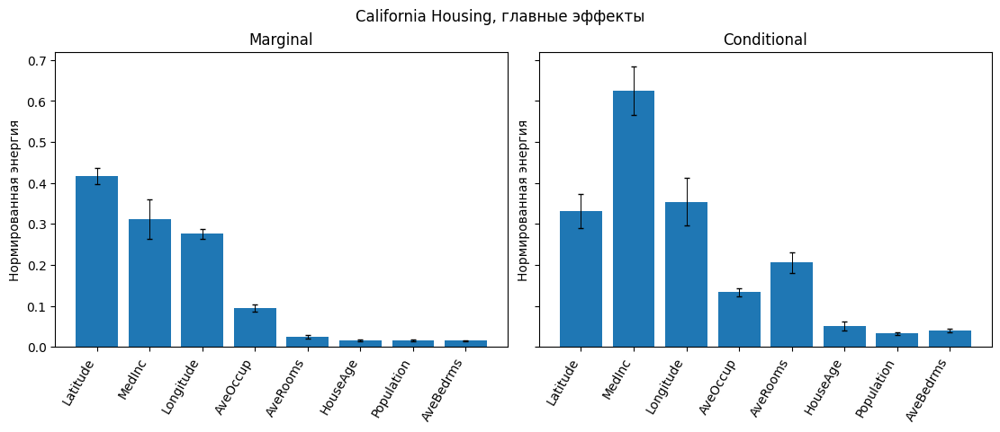
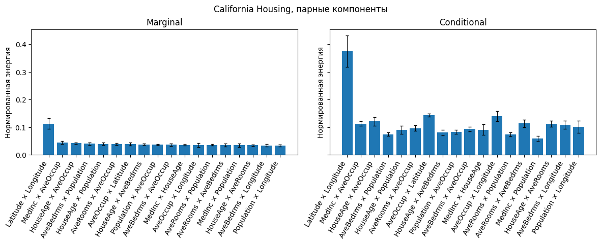
 
**Airfoil**

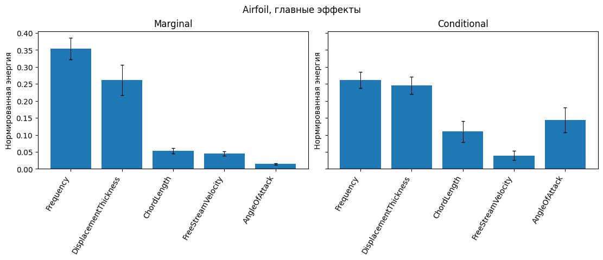
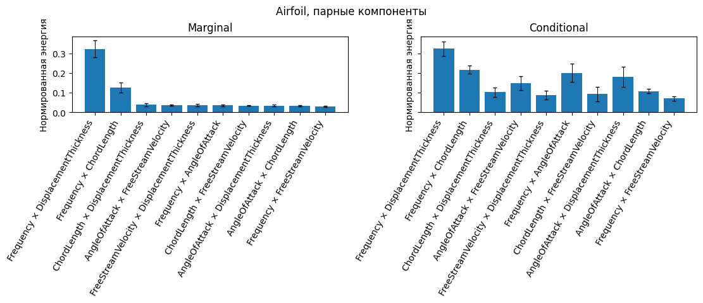

**Вывод:** топовые важности и взаимодействия совпадают с теми, которые обнаруживали другие методы.