Проверяем как точные и коррелирующие копии влияют на качество предсказания MLP, важность признаков и силу взаимодействий методом Neural Interaction Detection (NID).

Используем 8 разных синтетических функций. Каждая используем одну и ту же базу из 30000 объектов на Train, 5000 Validation, 5000 Test. Все 6 признаков объектов из N(0, 1). Также используем 3 датасета реальных данных. К синтетике добавлен независимый шум. Используем параметр $\rho$ - корреляция. Копии первого признака $x_1$ равны $z_j=\rho x_1+\sqrt{1-\rho^2}\varepsilon_j$. При $\rho=1$ копии точные, при $\rho=0$ — независимые шумовые признаки.

Для каждой задачи считаем взаимодействия пар по методу NID, а также важность через RMS градиента.

**Синтетика:**
1. Additive. $y = x_1 + x_2 + 0.6\times\sin{(x_3)}$
2. Product. $y = x_1 \times x_2$
3. Weak Pair. $y = x_1 \times x_2 + 0.3 \times x_3 \times x_4$
4. Triple. $x_1 \times x_2 \times x_3$
5. Sin Product. $\sin{(3\times x_1 \times x_2)}$
6. Squre Sum. $y = (x_1 + x_2)^2$
7. Threshhold. $y = (x_1 > 0) \land (x_2 > 0) \land (x_3 > 0)$
8. Fourth. $y = 5\times x_1 + x_2 \times x_3 \times x_4 \times x_5$

**Реальные данные:**
1. California Housing, 20 640 объектов, 8 признаков
2. Credit Default, 30 000 объектов, 23 признака, бинарная классификация
3. Airfoil Self-Noise, 1503 измерения, 5 признаков

# СИНТЕТИКА

## КАЧЕСТВО В ЗАВИСИМОСТИ ОТ ЧИСЛА КОПИЙ
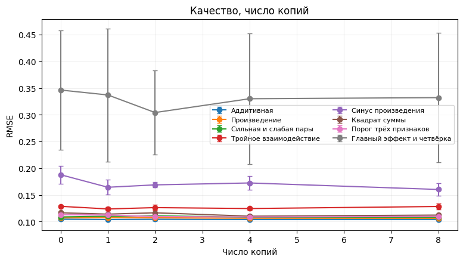

**Вывод:** копии практически не влияют на качество предсказания.

## ВАЖНОСТЬ В ЗАВИСИМОСТИ ОТ ЧИСЛА КОПИЙ
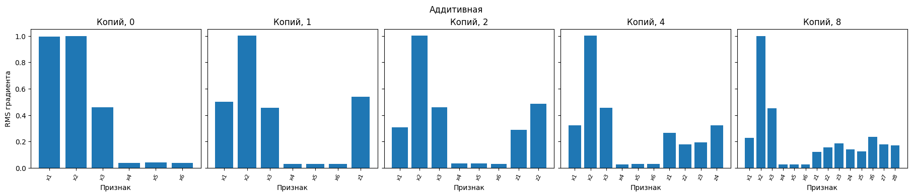
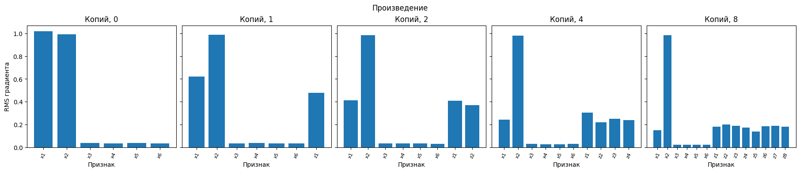
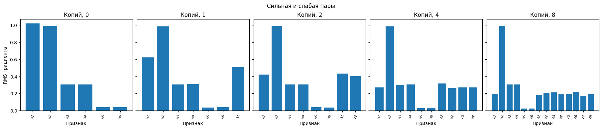
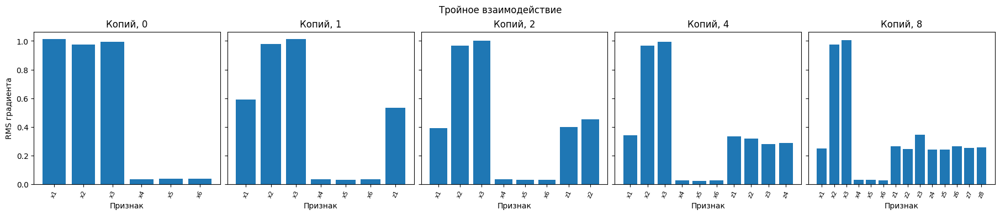
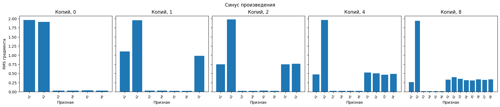
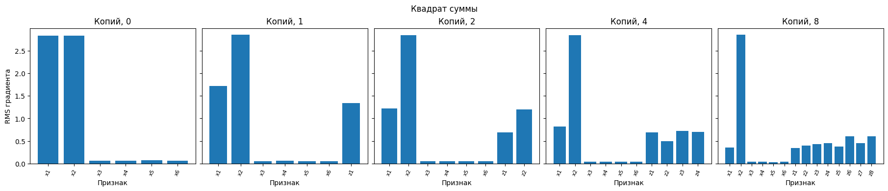
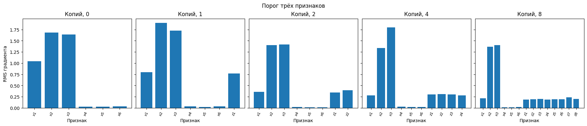
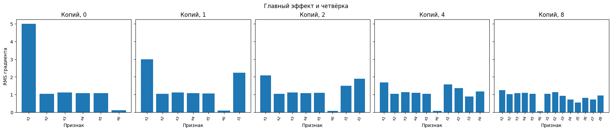

**Вывод:** как и ожидалось, важность перераспределяется между копиями.

## СИЛА ВЗАИМОДЕЙСТВИЯ В ЗАВИСИМОСТИ ОТ ЧИСЛА КОПИЙ
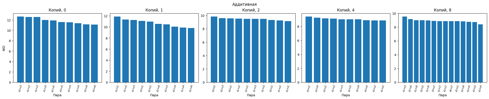
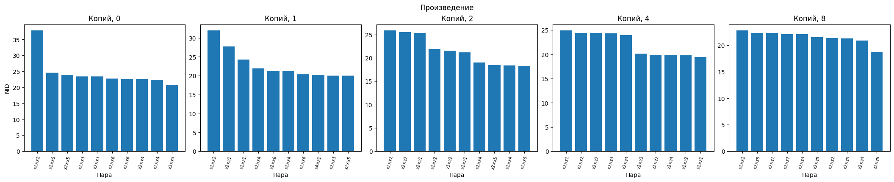
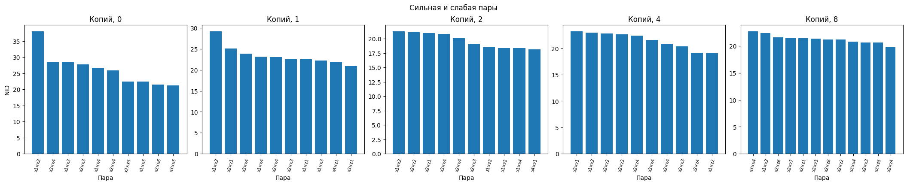
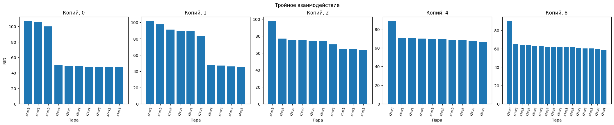
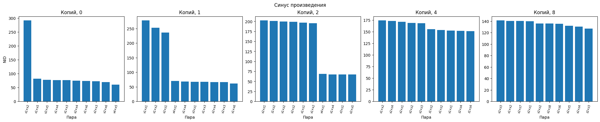
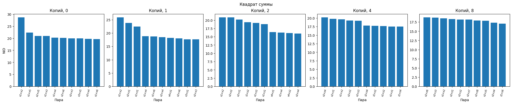
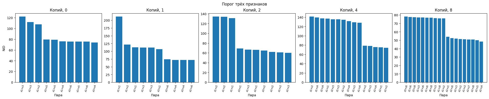
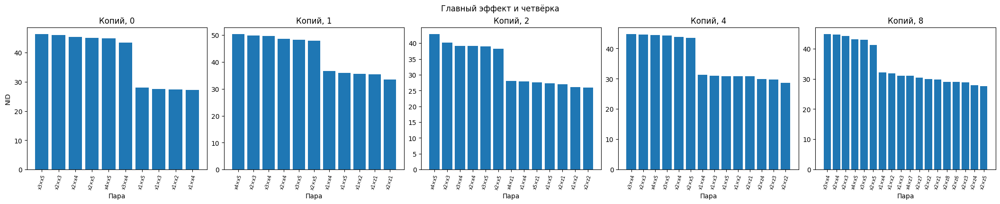

**Вывод:** как и ожидалось, с повышением числа копий сила взаимодействия уменьшается между копируемым признаком и его парой, например при 8 копиях в Weak Pair, взаимодействие становится слабее слабой пары. Интересно, что получилось в примерах с синусом произведения, квадрате суммы и Threshhold. Там добавление копии вывели в лидеры взаимодействие $x_1\times z_j$, которого на самом деле нет, это артефакт копирования признаков. Для этих вариантов проведем дополнительное сравнение с RIT, а также попробуем объяснить этот эффект.

# РЕАЛЬНЫЕ ДАННЫЕ
## ВАЖНОСТЬ В ЗАВИСИМОСТИ ОТ ЧИСЛА КОПИЙ
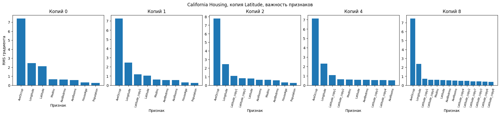
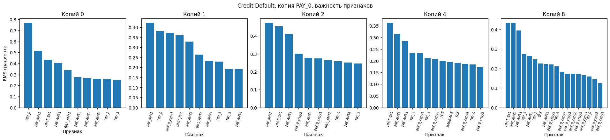
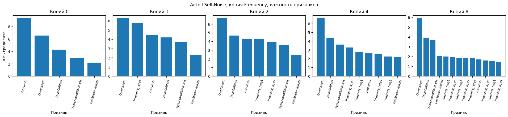
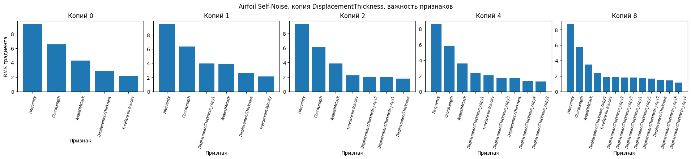

**Вывод:** аналогично синтетике важность перераспределяется между копиями.

## СИЛА ВЗАИМОДЕЙСТВИЯ В ЗАВИСИМОСТИ ОТ ЧИСЛА КОПИЙ
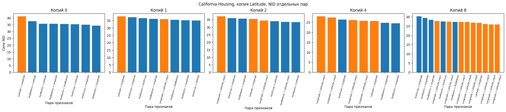
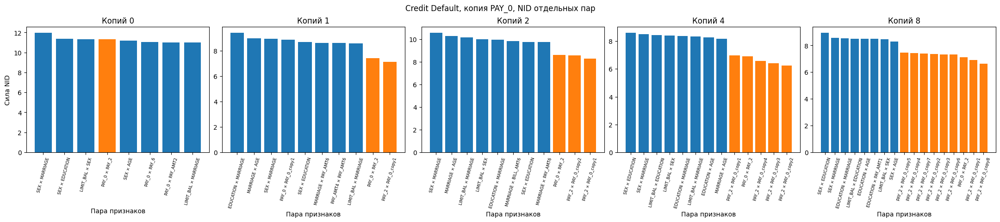
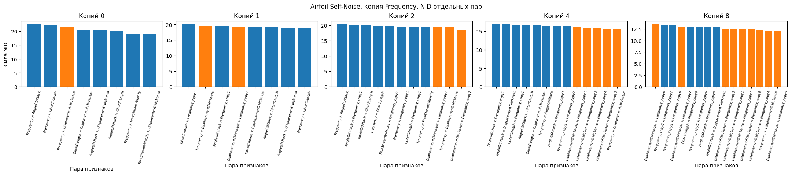
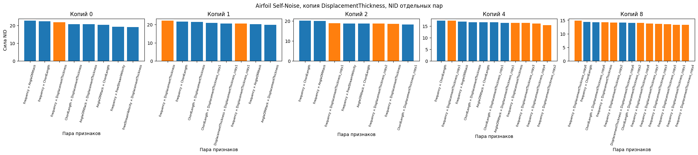

**Вывод:** сила взаимодействия в основном падает, но это не правило.

# ИССЛЕДОВАНИЕ ЭФФЕКТА ВЗАИМОДЕЙСТВИЯ ИСТИННОГО ПРИЗНАКА С ДУБЛИКАТОМ

Итак, мы наблюдали эффект, когда при копировании $x_1$, он начинал взаимодействовать с $z_j$, при чем это было одно из топовых взаимодействий. Для начала сравним, как с этим же экспериментом справится RIT:

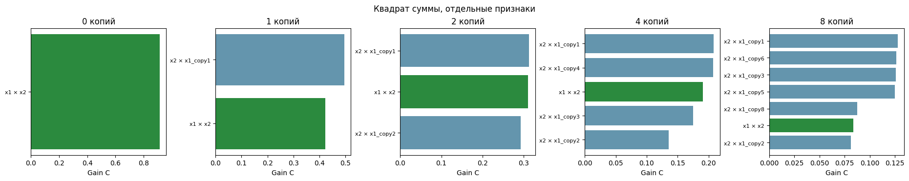
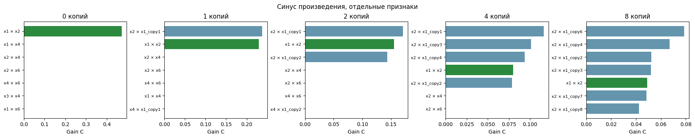

**Вывод:** RIT не находит ложного взаимодействия $x_1, z_j$

Попытаемся объяснить этот эффект длля нейросети. Покажем, что:

**при наличии точных копий признака нейросеть может выучить функцию с ненулевым взаимодействием между оригиналом и копиями, даже если в истинной функции такого взаимодействия нет. Причём качество предсказания на допустимых данных может быть идеальным**

Пусть $F(x,z)$ — функция двух переменных. Взаимодействие между $x$ и $z$ отсутствует (согласно статье), если функцию можно представить в виде

$$
F(x,z)=g(x)+h(z)
$$

Если $F$ дважды непрерывно дифф-ма на прямоугольной области, это то же что

$$
\frac{\partial^2 F(x,z)}{\partial x\,\partial z}\equiv 0
$$

Для недифф-х функций можно использовать смешанную конечную разность:

$$
\Delta_{xz}F=F(a,c)-F(a,d)-F(b,c)+F(b,d)
$$

Взаимодействие отсутствует тогда и только тогда, когда $\Delta_{xz}F=0$ для всех $a,b,c,d$ в соответствующей области

Пусть исходная функция y имеет вид

$$
y=f(x,u),
$$

где $u$ обозначает остальные признаки. Добавим копию $z=x$

Построим функцию

$$
F(x,z,u)=f\left(\frac{x+z}{2},u\right)
$$

На $z=x$:

$$
F(x,x,u)=f\left(\frac{x+x}{2},u\right)=f(x,u)
$$

Таким образом, $F$ в точности совпадает с исходной функцией

Обозначим $t=(x+z)/2$. По правилу дифф-я сложной функции

$$
\frac{\partial F}{\partial x}=\frac12\frac{\partial f(t,u)}{\partial t},
$$

а затем

$$
\frac{\partial^2F}{\partial x\,\partial z}=\frac14\frac{\partial^2f(t,u)}{\partial t^2}
$$

Поэтому, если $f$ дважды непрерывно дифференцируема и нелинейна по $x$ в смысле $\partial^2 f/\partial x^2\not\equiv 0$, то $F$ содержит взаимодействие между $x$ и $z$, несмотря на $z=x$

Посмотрим на пример синус произведения

Пусть

$$
f(x_1,x_2)=\sin(x_1x_2),\qquad z=x_1
$$

Тогда

$$
F(x_1,z,x_2)=\sin\left(\frac{x_1+z}{2}x_2\right)
$$

$$
F(x_1,x_1,x_2)=\sin(x_1x_2)=f(x_1,x_2)
$$

$$
\frac{\partial^2F}{\partial x_1\,\partial z}=-\frac{x_2^2}{4}\sin\left(\frac{x_1+z}{2}x_2\right)
$$

Она не равна нулю везде, например, при $x_1=z=1$ и $x_2=\pi/2$:

$$
\frac{\partial^2F}{\partial x_1\,\partial z}=-\frac{\pi^2}{16}\ne0
$$

Т.о. $x_1$ и его точная копия $z$ взаимодействуют в функции $F$ хотя исходная зависимость $f(x_1,x_2)$ не содержит отдельной переменной $z$

