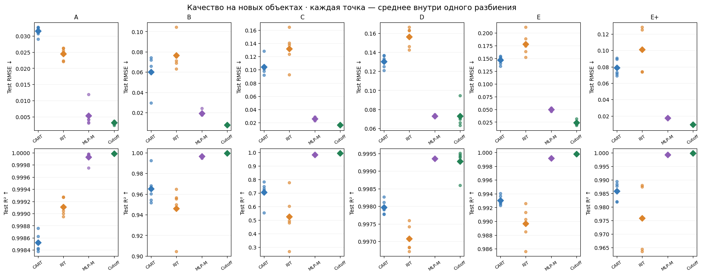
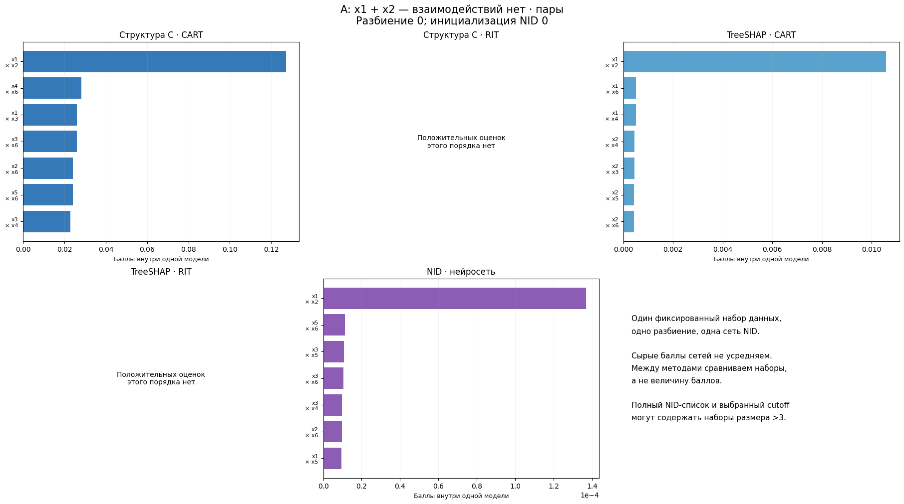
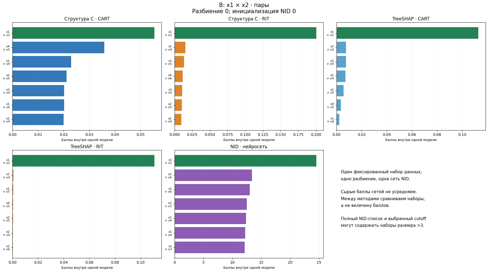
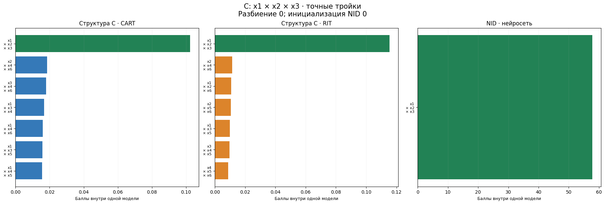
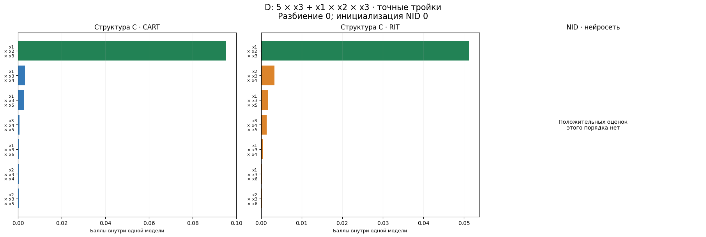
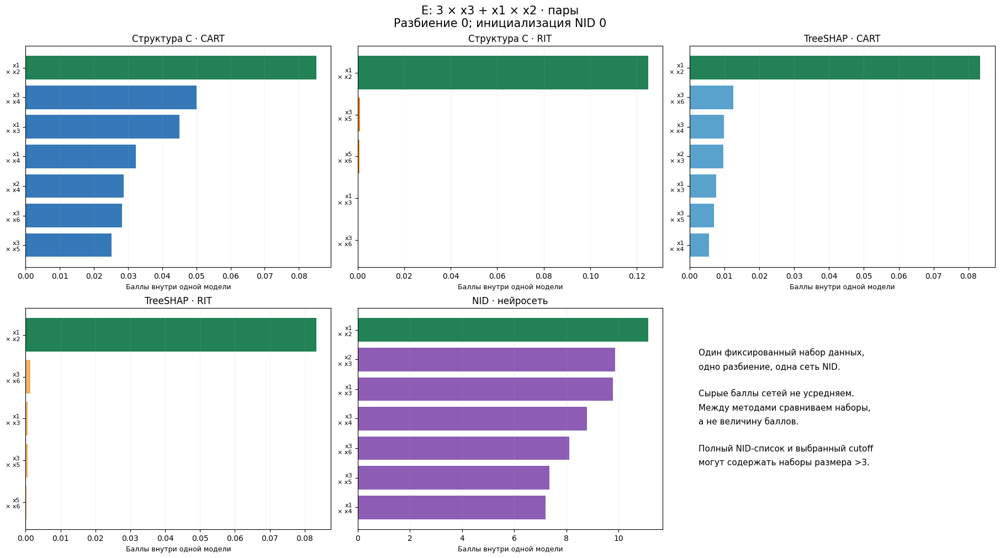
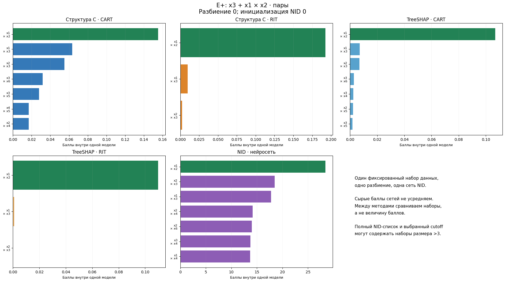
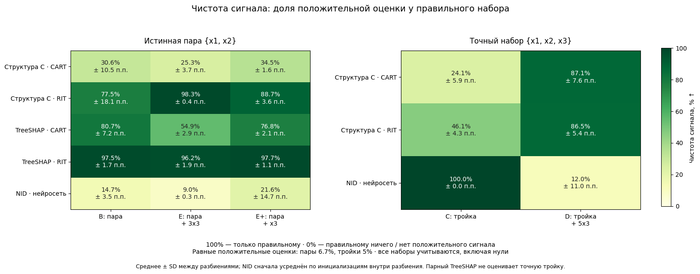

# Сравнение C, TreeSHAP и NID

Сравним способ C и TreeSHAP на обычном и консервативном бустинге, а также NID

Для C и TreeSHAP используем одни и те же обученные деревья. Сначала подбираем параметры бустингов, затем считаем оценки взаимодействий. NID применяем к отдельно обученной нейросети

(Способ С: с нормировкой каждого дерева по его полному Gain и последующим усреднением)

## Данные и подбор параметров

Признаки $x_1 - x_6$ - из равномерного распределения от -1 до 1. y задается формулой, пока без шума. 1280 на Train, доп E+ - 3000. Для каждой формулы ещё 12к на тест

CV 3 фолда по RMSE, loss на тесте - квадратичный

NID: MLP-M с одномерными ветвями и 10 инициализациями на каждом из 5 разбиений. Сначала усредняем показатели инициализаций внутри разбиения, затем самих разбиений

## Проверяем шесть задач

- **A:** $y = x_1 + x_2$, нет взаимодействия, нет истинной пары
- **B:** $y = x_1 \times x_2$, пара $x_1, x_2$
- **C:** $y = x_1 \times x_2 \times x_3$, тройка $x_1, x_2, x_3$
- **D:** $y = 5 \times x_3 + x_1 \times x_2 \times x_3$, тройка за сильным основным эффектом
- **E:** $y = 3 \times x_3 + x_1 \times x_2$, пара за сильным основным эффектом
- **E+:** $y = x_3 + x_1 \times x_2$, больше данных, основной эффект слабее

## Качество предсказаний

Нейросеть лучше предсказывает ответ на задачах с тройкой

## Какие взаимодействия выделяют методы

У каждого способа своя шкала баллов, поэтому сравниваем, насколько правильный набор выделяется среди остальных внутри одного метода. Зелёным отмечен истинный набор, в задаче A истинных взаимодействий нет

**A: сумма, истинных взаимодействий нет.**

**B: произведение двух признаков.**

**C: чистая тройка.**

**D: тройка с сильным одномерным эффектом.**

**E: пара с сильным одномерным эффектом.**

**E+: больше данных и более слабый одномерный эффект.**

## Насколько уверенно выделяется правильный набор

## Вывод

Для поиска пар лучше всего показало себя сочетание RIT + TreeSHAP: средняя чистота — 97.1% против 88.2% у RIT + C

Для точных троек способ C на RIT дал более высокую среднюю чистоту, чем на CART: 66.3% против 55.6% (ура)
