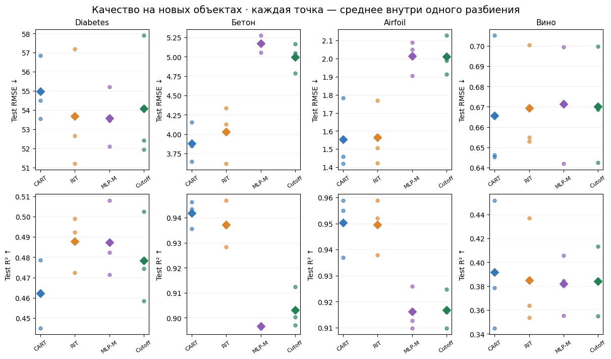
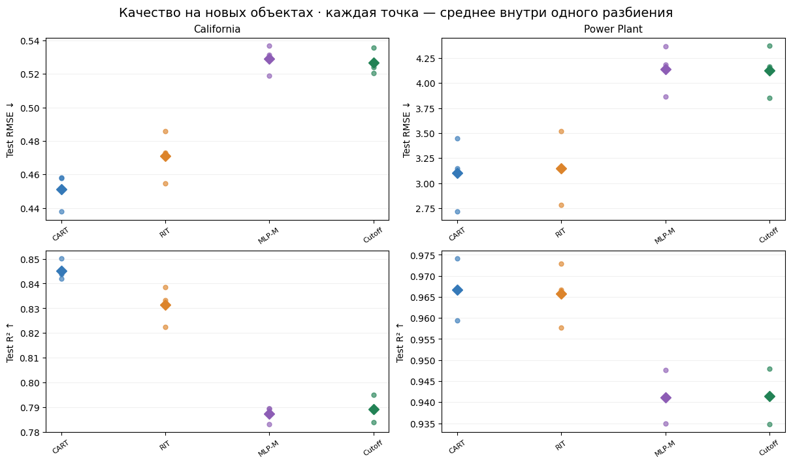
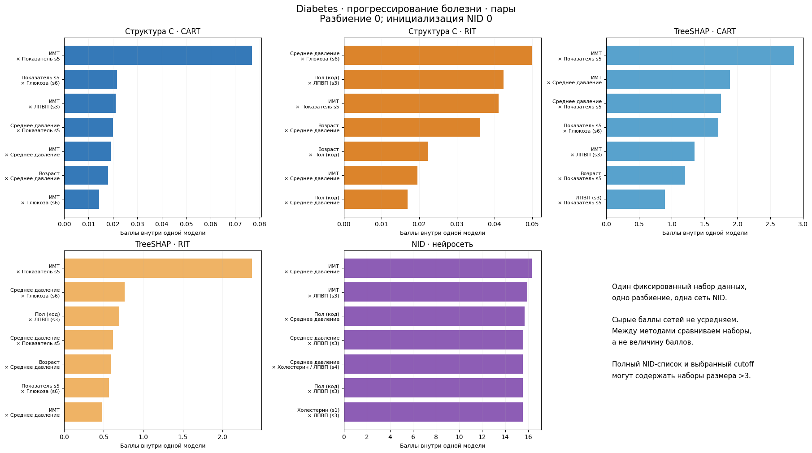
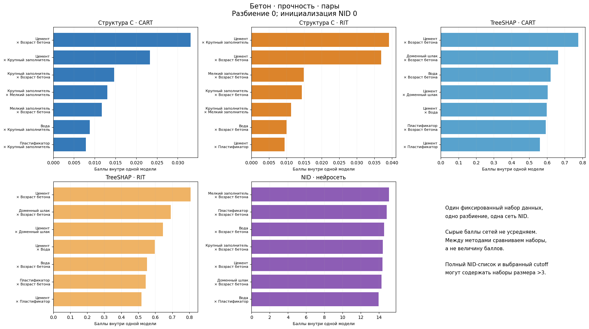
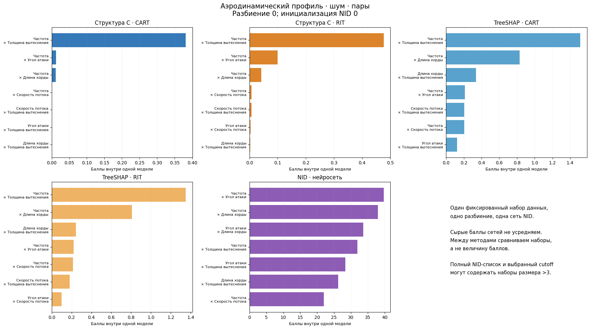
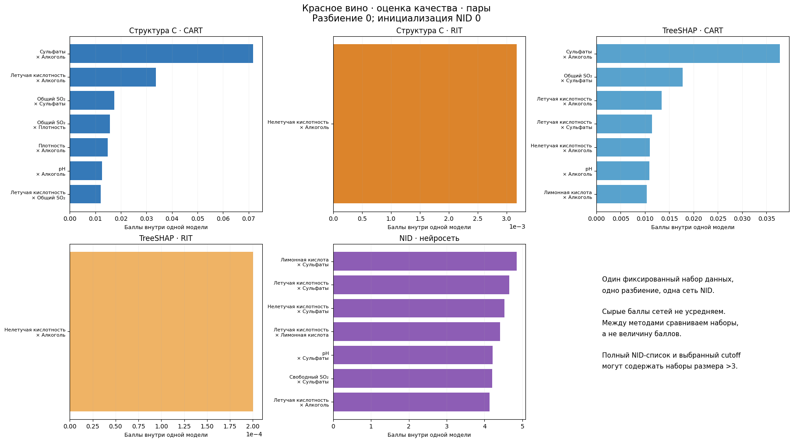
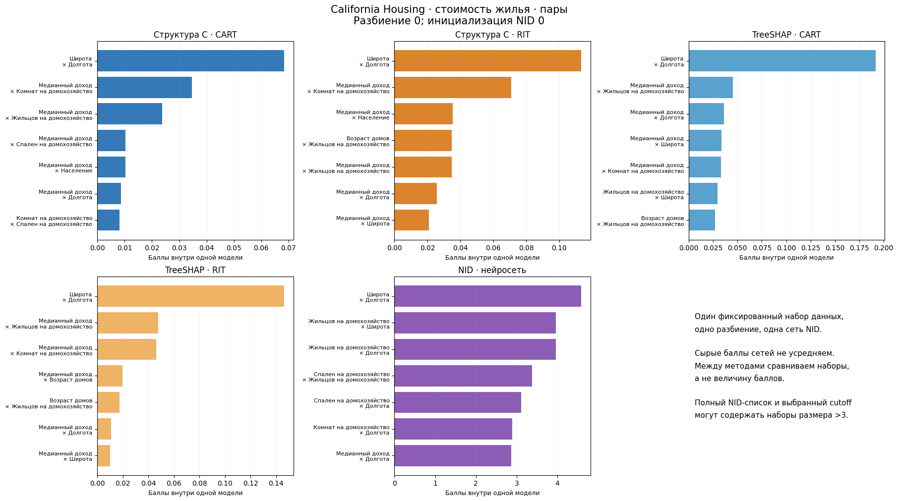
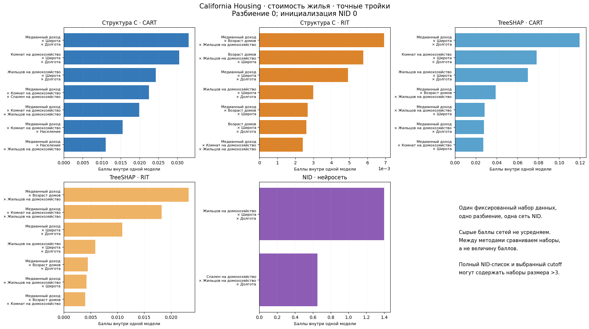
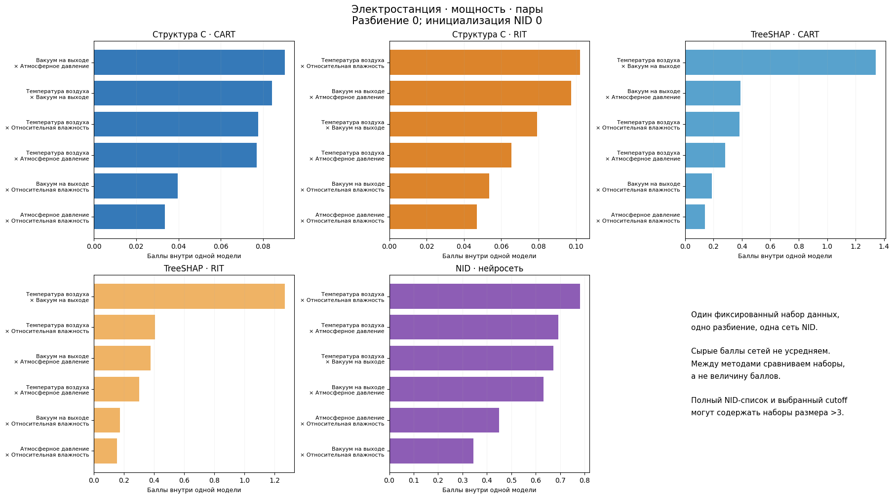
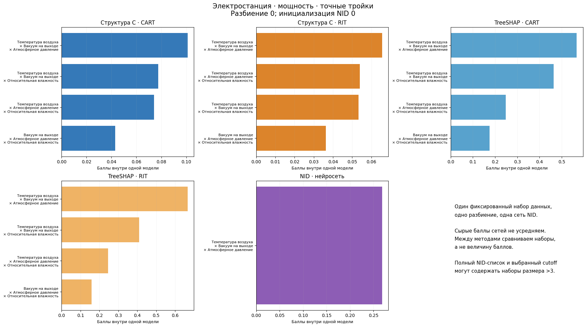

# Сравнение C, TreeSHAP и NID

Сравним способ C и TreeSHAP на обычном и консервативном бустинге, а также NID

Для C и TreeSHAP используем одни и те же обученные деревья. Сначала подбираем параметры бустингов, затем считаем оценки взаимодействий. NID применяем к отдельно обученной нейросети

(Способ С: с нормировкой каждого дерева по его полному Gain и последующим усреднением)

## Данные и подбор параметров

Реальные данные:

- Diabetes, 442 пациентов, 10 признаков
- Concrete,	1030 измерений, 8 признаков
- Airfoil, 1503 измерения, 5 признаков
- Wine Quality, 1599 образцов, 11 признаков
- California Housing, 20640 районов, 8 признаков
- Power Plant, 9568 измерений, 4 признака

CV 3 фолда по RMSE, loss на тесте - квадратичный

NID: MLP-M с одномерными ветвями и 10 инициализациями на каждом из 5 разбиений. Сначала усредняем показатели инициализаций внутри разбиения, затем самих разбиений

## Качество предсказаний

## Какие взаимодействия выделяют методы

У каждого способа своя шкала баллов, поэтому сравниваем, насколько правильный набор выделяется среди остальных внутри одного метода.

**Diabetes, пары**

С-RIT и TreeSHAP-RIT нашли общие топ-3 пары по взаимодействию, хотя их порядок и отличается. CART в обоих способах выделяет ИМТ - показатель s5, как и TreeSHAP-RIT, в то время как в C-RIT это взаимодействие только на 3 месте. Нейросеть судя по всему не обучилась хорошо на таком количестве данных.

**Бетон, пары**

Почти все способы выделяют цемент-возраст бетона как топ взаимодействие, но RIT на первое место ставит цемент-кр.заполнитель, а нейросеть мелк.заполнитель-возраст, т.о. можно сделать вывод что на прочность сильно влияет возраст

**Аэродинамический профиль, пары**

Здесь явно видно сильное взаимодействие частота-толщина вытеснения, хотя нейросеть опять идет вразрез и выделяет частота-угол атаки или частота-длина хорды, что странно, т.о. это один из самых убедительных результатов деревьев

**Красное вино, пары**

Здесь у RIT вообще только один кандидат, а CART выделяет сульфаты и алкоголь, нейросеть это не подтвердждает. Всё это может объясняться тем, что модели плохо выучили зависимость (R2 около 0.4) и вообще не выучили правильных взаимодействий.

**California Housing, пары**

Тут сочетание широта-долгота на первом месте у всех способов, что ожидаемо т.к. это очевидное взаимодействие

**California Housing, тройки**

Результат зависит от модели и нет конкретного лидера

**Электростанция, пары**

Оба TreeSHAP выделяют сильно температура - вакуум, C же больше склоняется к вакуум-давление, температура-влажность, хотя температура-вакуум входит в топ3

**Электростанция, тройки**

Тройку температура-вакуум-давление нашли все 5 способов согласованно

## Вывод

Можно указать что на одних и тех же деревьях C и TreeSHAP могут выбирать разных лидеров. Это видно в Concrete и Power Plant. Следовательно способ начисления баллов действительно влияет на выводы даже при полностью одинаковой обученной модели

