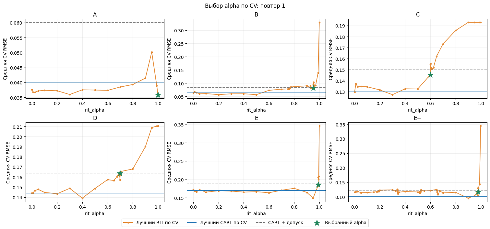
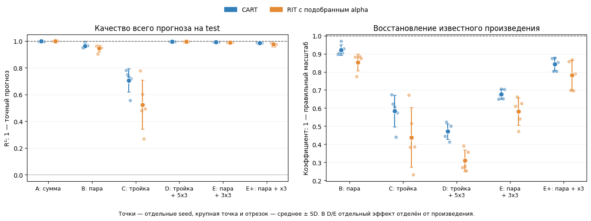
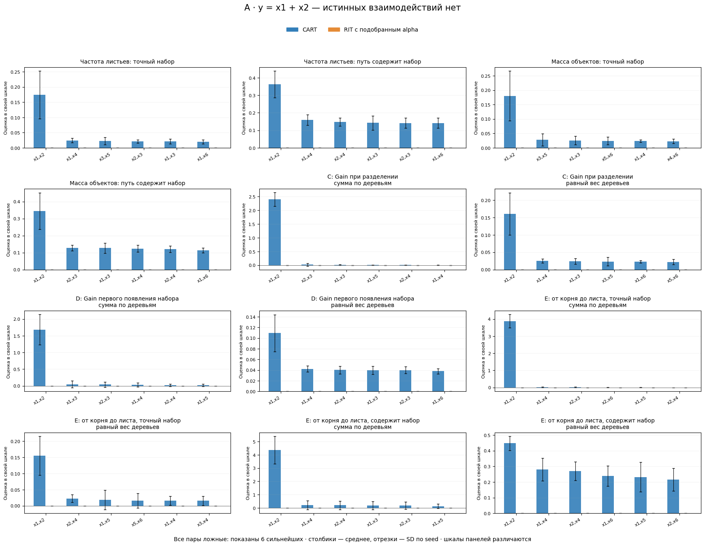
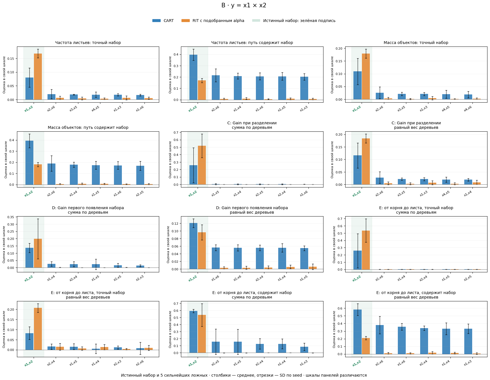
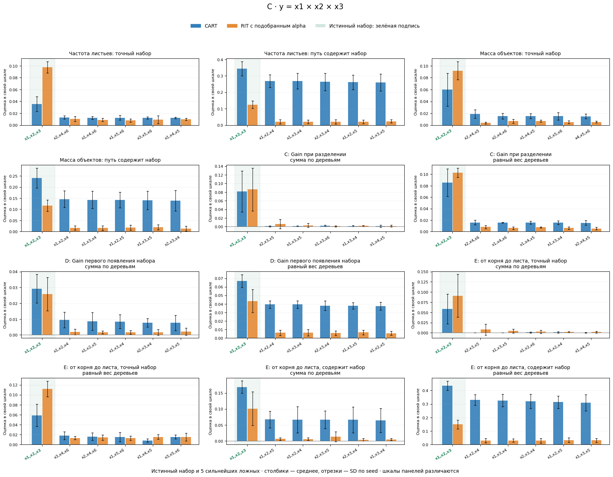
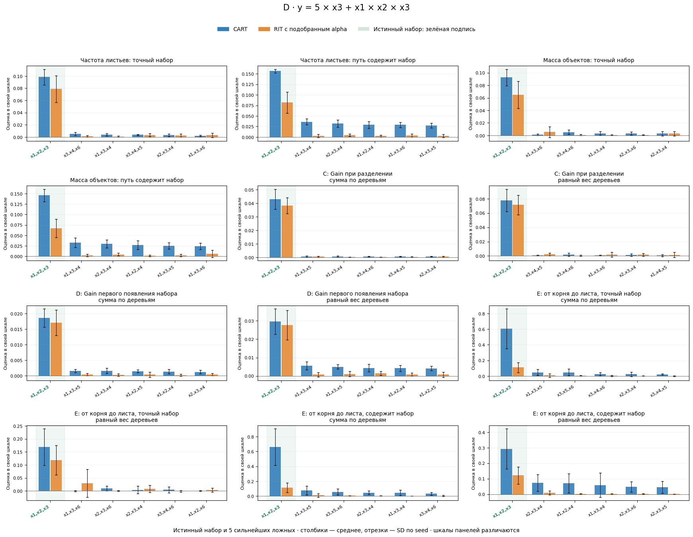
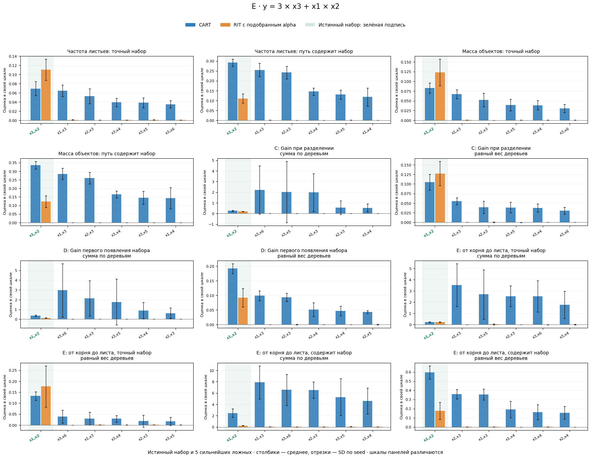
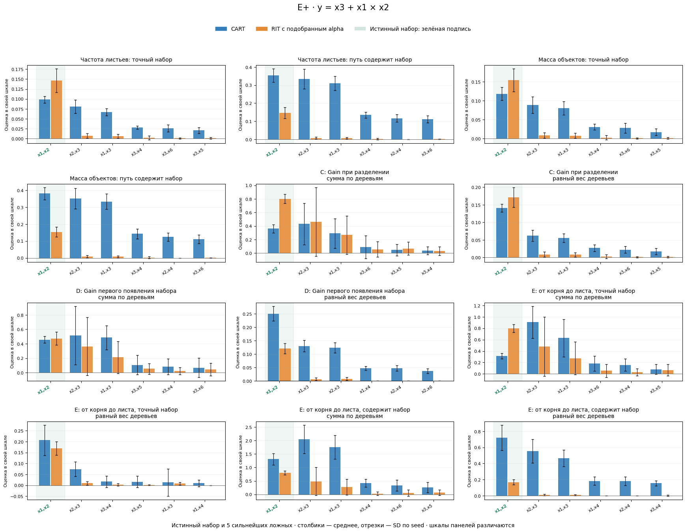
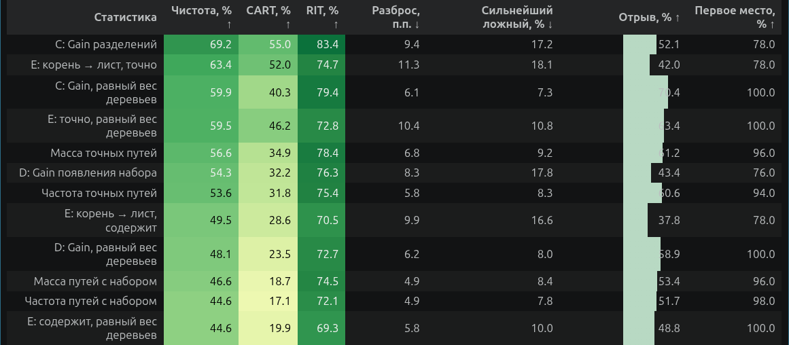
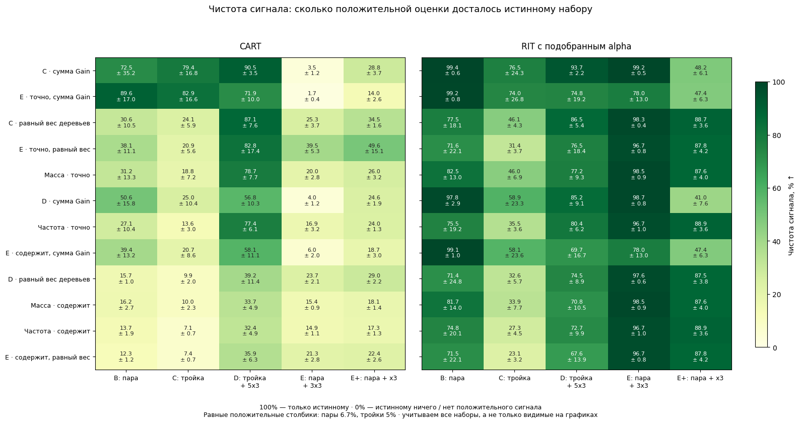

Сравним различные способы оценки взаимодействия по структуре деревьев консервативного бустинга. Будем подбирать гиперпараметры с помощью CV, а alpha с помощью проверки гипотезы о статистически значимом падении качества.

Признаки $x_1 - x_6$ - из равномерного распределения от -1 до 1. y задается формулой, пока без шума. 1280 на Train, доп E+ - 3000. Для каждой формулы ещё 12к на тест

CV 3 фолда по RMSE, loss на тесте - квадратичный

## Будем проверять на 6 задачах:

- **A:** $y = x_1 + x_2$, нет взаимодействия, нет истинной пары
- **B:** $y = x_1 \times x_2$, пара $x_1, x_2$
- **C:** $y = x_1 \times x_2 \times x_3$, тройка $x_1, x_2, x_3$
- **D:** $y = 5 \times x_3 + x_1 \times x_2 \times x_3$, тройка за сильным основным эффектом
- **E:** $y = 3 \times x_3 + x_1 \times x_2$, пара за сильным основным эффектом
- **E+:** $y = x_3 + x_1 \times x_2$, больше данных, основной эффект слабее

## Выбор $\alpha$:

## Качетво подобранных моделей:

## Теперь способы, которые сравниваем:

во-первых, они делятся на то, как мы считаем, что признаки на пути - точный (exact) (ровно эти признаки на пути, других нет), путь содержит набор (subset) (на пути могут быть и другие признаки), во-вторых в случаях с Gain можно складывать оценки всех деревьев и можно нормировать на весь свой Gain каждое дерево а затем усреднять. Т.о.:

- **A exact_frequency:** доля листьев, точный, листья с одинаковым весом
- **A subset_frequency:** доля листьев, subset
- **B exact_mass:** доля объектов, попавших в листья, точный
- **B subset_mass:** доля объектов, попавших в листья, subset
- **C Gain разделений:** здесь каждому сплиту приписывается набор всех различных признаков, использованных от корня до этого сплита включительно (по сути set признаков), его Gain целиком получает этот набор (2 версии)
- **D Gain появления набора:** набор признаков получает Gain только тех сплитов, которые впервые собрали его целиком на данном пути (2 версии)
- **E:** насколько меньше разброс в листе, чем в корне, с учётом размера листа ($S(l) = \frac{W_l}{W_{root}}(I_{root} - I_{l})$), весь этот вклад получает полный набор признаков пути к листу (4 версии, exact/subset sum/normalised)

**В А** видно, что RIT не увидел взаимодействия во всех 12 способах, в то время как CART везде выделил пару $x_1, x_2$

**В B** видно, что и RIT и CART верно определили взаимодействие, но RIT делает это более выражено, отметим что способы C1 и Е1 справились лучше всего

**В С** (тройка) опять же верно найдено взаимодействие, опять же отметим C1 и Е1

**В D** аналогично С

**В E** видим коллапс  CART, он неправильно определил взаимодействие на 4\12 способах, считая С1 и Е1, в то время как RIT везде правильно определил взамодействие

**В E+** аналогично E, но менее уверенные оценки с большой долей ложных оценок в некоторых способах

## В итоге сравним, насколько уверенно каждый способ предсказывал взаимодействие, cравним такие статистики:

- Чистота = 100 * правильный столбик / (правильный + все ложные)
- Сильнейший ложный = 100 * сильнейший ложный / (правильный + все ложные)
- Отрыв = 100 * (правильный − сильнейший ложный) / (правильный + сильнейший ложный)
- Разброс = средний по задачам и моделям разброс чистоты между seed

**Исходя из всего этого выбираем в качестве способа - C, сумму Gain по деревьям**
